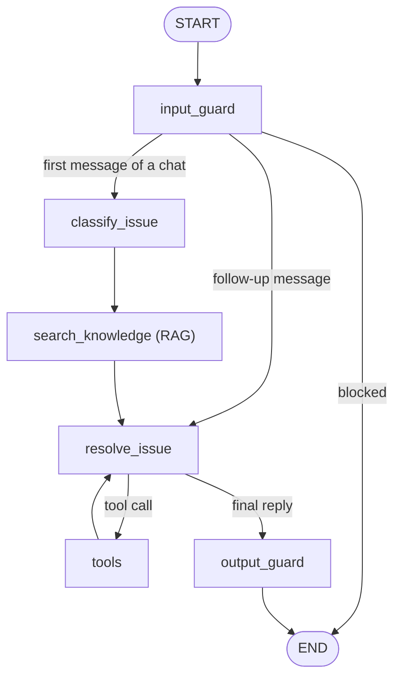

# BE: SkyDesk AI backend

FastAPI + LangGraph. This folder holds all the business logic: the agent, the tools, RAG, the data and login.
The frontend only displays what these endpoints return.

For the problem statement and the overall architecture, see the [root README](../README.md).

## Contents

1. [Setup and run](#1-setup-and-run)
2. [Folder layout](#2-folder-layout)
3. [Configuration (.env)](#3-configuration-env)
4. [The agent graph](#4-the-agent-graph)
5. [System prompts](#5-system-prompts)
6. [Tools](#6-tools)
7. [RAG: Pinecone](#7-rag-pinecone)
8. [MongoDB: business data and memory](#8-mongodb-business-data-and-memory)
9. [Guardrails](#9-guardrails)
10. [Login, JWT and roles](#10-login-jwt-and-roles)
11. [Endpoints](#11-endpoints)
12. [Streaming (server-sent events)](#12-streaming-server-sent-events)
13. [Human approval: pause and resume](#13-human-approval-pause-and-resume)

---

## 1. Setup and run

Python 3.11.9 (see `.python-version`).

```bash
cd BE
python -m venv .venv
source .venv/bin/activate
pip install -r requirements.txt

cp .env.example .env                        # then fill in the secrets (section 3)
python -m scripts.ingest_kb                 # load data/kb into Pinecone (once, and after editing a document)
uvicorn main:app --reload --port 8000       # API docs: <backend URL>/docs
```

Check that it is running: `GET /health` returns `{"status": "ok", "mongodb": "connected"}`.

## 2. Folder layout

```
main.py                    FastAPI app: CORS, routers, "LLM busy" error handler, /health
requirements.txt           dependencies, grouped by phase
app/
  config/settings.py       reads every value from .env (no defaults in code)
  core/
    domain.py              business vocabulary: categories, priorities, teams, statuses, levels
    llm_client.py          the Groq chat model
  db/
    mongo.py               MongoDB client, collections, helpers (now, next_id, out, ping)
    vector_store.py        Pinecone index, embeddings, reranker
  agent/
    state.py               AgentState: what every graph node reads and writes
    graph.py               the LangGraph workflow + MongoDB checkpointer
    nodes/                 classify_issue.py, search_knowledge.py, resolve_issue.py
  prompts/                 classify_issue.txt, resolve_issue.txt (system prompts)
  tools/                   one file per LLM tool; __init__.py lists them in TOOLS
  guardrails/              rules.py, input_guard.py, output_guard.py
  services/                business logic shared by the API and the tools
  api/                     HTTP endpoints, one file per area; deps.py = login and role checks
data/kb/                   the 2 knowledge base documents (RAG source)
scripts/ingest_kb.py       chunks data/kb and stores it in Pinecone
```

How the layers depend on each other: **api → agent → tools → services → db**.
The API and the tools both call the same services, so a ticket created by the agent and one updated by an engineer go through the same code.

## 3. Configuration (.env)

Every value comes from `BE/.env`. `settings.py` has no defaults, so a missing key stops the app at startup.
Secrets (API keys, the database URI, the JWT secret) are read as `SecretStr` and never printed.
**`BE/.env.example` lists every key with an example value:** copy it to `.env` and fill in the secrets.

| Key | Used for |
|---|---|
| `APP_NAME`, `APP_VERSION` | API title and version |
| `AIRLINE_NAME` | airline name in guardrail replies and /meta |
| `GROQ_API_KEY` | Groq API key (secret) |
| `GROQ_MODEL` | the LLM used by every agent step |
| `GROQ_TEMPERATURE`, `GROQ_TIMEOUT`, `GROQ_MAX_RETRIES`, `GROQ_REASONING_EFFORT` | LLM behaviour |
| `MONGODB_URI`, `MONGODB_DB` | Atlas connection string (secret), database name |
| `SLA_HOURS` | SLA hours per priority (JSON) |
| `SIMILAR_TICKETS_LIMIT` | how many tickets find_similar_tickets returns |
| `AGENT_RETRY_ATTEMPTS` | retries when the LLM writes a broken tool call |
| `TICKET_ID_PREFIX`, `APPROVAL_ID_PREFIX` | prefixes of new ticket and approval IDs (`<prefix>-<number>`) |
| `ACCESS_APPROVER_TEAM` | IT team whose engineers may approve any access request |
| `PINECONE_API_KEY`, `PINECONE_INDEX` | Pinecone API key (secret), index name |
| `PINECONE_CLOUD`, `PINECONE_REGION` | where the index is created |
| `PINECONE_EMBED_MODEL`, `PINECONE_EMBED_DIMENSION` | hosted embedding model and its vector size |
| `PINECONE_RERANK_MODEL` | hosted reranking model |
| `RAG_KB_DIR`, `RAG_CHUNK_SIZE`, `RAG_CHUNK_OVERLAP` | ingestion: document folder, chunk size and overlap (characters) |
| `RAG_TOP_K`, `RAG_TOP_N` | retrieval: candidates from vector search, how many the reranker keeps |
| `JWT_SECRET` | signs login tokens (secret, random hex) |
| `JWT_ALGORITHM`, `JWT_EXPIRE_MINUTES` | token signing algorithm and lifetime (minutes) |
| `CORS_ORIGINS` | frontend addresses allowed to call the API (JSON list) |

## 4. The agent graph

`app/agent/graph.py` is a LangGraph `StateGraph` over `AgentState`.



| Node | Type | What it does | Writes to state |
|---|---|---|---|
| `input_guard` | code | Blocks passwords and prompt injection, redacts emails and card numbers (section 9) | `blocked`, `guardrails`, cleaned message |
| `classify_issue` | LLM, structured output | Reads the message and returns a Pydantic `IssueClassification`. If no airport is mentioned, it uses the employee's location from MongoDB. | `category`, `priority`, `team`, `airport`, `reason` |
| `search_knowledge` | RAG | Searches Pinecone with `"{category}: {message}"`. **Always runs before any MongoDB tool.** | `knowledge` (the best `RAG_TOP_N` sections) |
| `resolve_issue` | LLM with tools | Gets the system prompt plus the classification, the knowledge and the chat. Either calls **one** tool or writes the reply. Retried up to `AGENT_RETRY_ATTEMPTS` times on Groq `BadRequestError`. | new AI message |
| `tools` | `ToolNode` | Runs the chosen tool and returns its result to `resolve_issue` | tool message |
| `output_guard` | code | Checks the final reply before the employee sees it (section 9) | cleaned reply, `guardrails` |

**State** (`state.py`): `AgentState` extends `MessagesState`, so `messages` is appended to, not replaced. It adds:
- `employee_id`, set from the JWT and never from the LLM;
- the classification fields;
- `knowledge`;
- `blocked` and `guardrails`.

**Memory:** the graph is compiled with `MongoDBSaver`, so every chat (`thread_id`) is saved in MongoDB and survives a restart. Classification runs once per chat. Follow-ups ("still not working") go straight to `resolve_issue` with the earlier state.

Runs use `durability="exit"`: state is saved only when the run ends, after `input_guard` has removed any password, so a password is never written to the checkpoint.

## 5. System prompts

Prompts are plain text files in `app/prompts/`. They are read once at startup and filled with `str.format`.

**`classify_issue.txt`**: the triage rules.
- **Step 1:** is the employee asking to *be given* access, or for a password reset? Then it is an Access Request for Identity & Access Management.
- **Step 2:** otherwise the category gives the team:

  | Category | Team |
  |---|---|
  | Check-in Application, Crew Scheduling, ERP | Application Support |
  | Network | Network Support |
  | Printer, Barcode Scanner | Hardware Support |
  | Email / M365, Other | IT Support |

- **Priorities:**
  - P1 = whole airport or flight operations stopped
  - P2 = one counter or employee cannot serve passengers
  - P3 = degraded, with a workaround
  - P4 = access, question, minor issue
- **Airport:** an IATA airport code, or UNKNOWN.

**`resolve_issue.txt`**: the agent's playbook. Placeholders: `{employee_id}`, `{category}`, `{priority}`, `{team}`, `{airport}`, `{knowledge}`.

1. **Hardware:** ask for the device ID and the error first.
2. **Network / Check-in:** call `find_similar_tickets` first.
   - 2+ open reports from others at the same airport: one P1 ticket listing them, assigned to L2.
   - An open P1 already exists: `update_ticket` on it instead of creating a new ticket.
3. **Self-service:** give only the `[Employee]` steps from the retrieved SOP and cite the SOP ID. Never give `[IT only]` steps. No ticket in the same reply.
4. **Still not working:** `create_ticket`, then `assign_ticket`. L1 normally; L2 for P1 or repeated failures.
5. **Access requests:** never grant access. Use the policy from the knowledge, then `get_employee_profile`, then `create_ticket`, then `request_approval`.
6. **"Where is my ticket?":** `get_ticket_status`.
7. **Fixed:** `update_ticket` to resolved.

Rules: one tool at a time; only state facts that came from tool results; short, plain replies.

## 6. Tools

Each tool is one file in `app/tools/`, defined with LangChain `@tool`. The docstring is what the LLM reads to decide when to use it.
Arguments typed with `domain.py` Literals (Category, Team, ...) restrict the LLM to valid values.
Tools that need to know who is chatting take a `ToolRuntime`. They read `employee_id` from the state and `thread_id` from the config, so the LLM never sees or sets them.

| Tool | Reads / writes | What it does |
|---|---|---|
| `search_knowledge_base(query, category?)` | Pinecone | Searches again when the topic changes mid-chat |
| `get_employee_profile(employee_id)` | MongoDB `users` | Name, title, department, location, manager |
| `find_similar_tickets(description, airport?)` | MongoDB `tickets` (text index) | Up to `SIMILAR_TICKETS_LIMIT` similar tickets, with status and time. Used to detect incidents. |
| `create_ticket(summary, category, priority, team)` | MongoDB `tickets`, `audit_logs` | New ticket: requester from the state, SLA from `SLA_HOURS`, linked to the chat `thread_id` |
| `assign_ticket(ticket_id, team, level)` | `tickets`, `audit_logs` | Routes the ticket to a team, L1 or L2 |
| `update_ticket(ticket_id, status, comment)` | `tickets`, `comments`, `audit_logs` | Changes the status, adds a comment (for example a second incident reporter) |
| `get_ticket_status(ticket_id)` | `tickets`, `comments` | Status and last comment. **Only the employee's own tickets.** |
| `request_approval(ticket_id, requested_access, reason)` | `approvals`, `tickets` | Creates the approval and **pauses the graph** with `interrupt()` (section 13) |

## 7. RAG: Pinecone

### What is in the vector DB
Synthetic documents written for this demo, in the folder `RAG_KB_DIR`. This is the demo content:

| Document | ID | Content |
|---|---|---|
| `airport_systems_troubleshooting_guide.md` | IT-KB-001 | 27 SOPs. Check-in app (SOP-APP-001…006), network and Wi-Fi (SOP-NET-001…004), boarding pass and bag tag printers (SOP-HW-001…004), barcode scanners (SOP-HW-010…013), crew scheduling (SOP-CRW-001…004), ERP (SOP-ERP-001…002), email and M365 (SOP-M365-001…003), and when to raise a ticket. Every step is tagged **[Employee]** or **[IT only]**. |
| `it_service_management_policy.md` | IT-POL-002 | Support teams, priorities and SLA, **major incident procedure** (§4), **access request and approval policy** (§5), password policy (§6), L1 → L2 escalation rules (§7), ticket lifecycle (§8), what the agent may and may not do (§9). |

### Ingestion (`scripts/ingest_kb.py`)
1. **Load** each `.md` file.
2. **Chunk by headings** with `MarkdownHeaderTextSplitter` (`#` document, `##` section, `###` SOP), so one chunk is one SOP or policy section. The heading stays in the text, so it is embedded too.
3. **Size limit** with `RecursiveCharacterTextSplitter`: `RAG_CHUNK_SIZE` characters with `RAG_CHUNK_OVERLAP` overlap, for long sections only.
4. **Embed and store:** Pinecone embeds each chunk with the hosted `PINECONE_EMBED_MODEL` (`PINECONE_EMBED_DIMENSION` dimensions, cosine similarity).
   - The chunks go into the index `PINECONE_INDEX` (created if missing); the script prints how many it stored.
   - IDs: `<file>-<n>`.
   - Metadata: `source`, `document`, `section`, `sop`.
   - The index is emptied first, so re-running never leaves old chunks.

Stop words are not removed: the embedding model works on full sentences, and words like "not" ("not printing") carry meaning.

### Retrieval (`services/knowledge_service.py`)
1. Query text: `"{category}: {employee message}"`.
2. **Semantic search:** the query is embedded with the same model; cosine similarity gives the top `RAG_TOP_K` chunks.
3. **Rerank:** the hosted `PINECONE_RERANK_MODEL` cross-encoder scores each candidate against the query, and the best `RAG_TOP_N` are kept.
4. Returns `source`, `section` (the SOP ID or policy section), the rerank `score` and the `text`.
   - The agent gets them in its prompt.
   - The chat shows them in Agent steps.
   - The ticket page shows them in the Knowledge tab.

Test it directly: `GET /knowledge/search?q=printer shows offline` (IT support login).

## 8. MongoDB: business data and memory

Database `MONGODB_DB` on MongoDB Atlas, accessed with PyMongo's async client.

| Collection | Holds | Demo data |
|---|---|---|
| `users` | employee ID (`_id`), name, title, department, location (IATA), role, manager_id, `password_hash` (Argon2) | synthetic employees, line managers and IT engineers (L1/L2) across the support teams |
| `tickets` | ID (`TICKET_ID_PREFIX`-number), title, description, category, priority, team, status, assignee (L1/L2), airport, requester, SLA hours, `thread_id` of the chat that created it | synthetic tickets across all categories and several airports, including a cluster of recent open network tickets at one airport (incident scenario) and repeated check-in timeouts at another (escalation scenario) |
| `comments` | ticket comments by the agent, engineers and approvers | engineer notes on the demo tickets |
| `audit_logs` | every change: who (agent or engineer name), what, when | history of the demo tickets |
| `approvals` | ID (`APPROVAL_ID_PREFIX`-number), ticket, requested access, reason, status, `thread_id`, decided_by, comment | pending and decided demo requests |
| `counters` | the next ticket and approval number | |
| `conversations` | chat list per employee: thread_id, title (cleaned by the guardrail), times | |
| `checkpoints`, `checkpoint_writes` | LangGraph chat memory and paused approvals (written by `MongoDBSaver`) | |

The demo data was loaded once with a one-off script, which was then removed. All names and tickets are synthetic.
`tickets` has a MongoDB text index (created with the demo data), which `find_similar_tickets` uses for keyword search.

## 9. Guardrails

`app/guardrails/` contains two graph nodes and their rules. They are deterministic, with no LLM calls, so they are fast and predictable.
PII detection uses LangChain's own detectors (`detect_email`, `detect_credit_card` from `langchain.agents.middleware.pii`).

| Where | Rule | Action |
|---|---|---|
| input | Password, PIN, OTP or MFA code shared ("my password is …") | The message is replaced in memory, the agent is **not called**, and the employee is told never to share it |
| input | Prompt injection ("ignore previous instructions", "reveal your prompt", …) | The agent is **not called**. Reply: "I can only help with <`AIRLINE_NAME`> IT support issues" |
| input | Email address or card number | Redacted to `[REDACTED_EMAIL]`, then the agent continues |
| output | Lines containing "IT only" | Removed: employees never see engineer-only steps |
| output | The agent asking for a password or code | The reply is replaced with a safe message |
| output | Email or card number in the reply | Redacted |

Each rule that fires is streamed to the chat as a `guardrail` step. Conversation titles go through the same cleaning before they are stored.

## 10. Login, JWT and roles

1. `POST /auth/login` (OAuth2 password form: `username` = employee ID, `password`).
2. `auth_service` checks the password against the Argon2 hash in `users` (pwdlib).
3. A JWT is issued: claims `sub` (employee ID), `role` and `exp`. Signed with `JWT_SECRET` using `JWT_ALGORITHM`, valid for `JWT_EXPIRE_MINUTES`.
4. The frontend sends `Authorization: Bearer <token>` on every call.
5. `api/deps.py`:
   - `current_user` decodes the token and loads the user (401 if it is invalid or expired);
   - `require_roles(...)` returns 403 for the wrong role.

The employee is always taken from the token, never from the request body. So the agent can only create tickets for, and read the tickets of, the logged-in employee.

## 11. Endpoints

All endpoints except login and health need a Bearer token. They can be tried at `<backend URL>/docs`: click **Authorize** and log in.

| Method | Path | Role | Purpose |
|---|---|---|---|
| POST | `/auth/login` | public | Employee ID + password → `access_token` + user |
| GET | `/auth/me` | any | The logged-in user |
| GET | `/meta` | any | Airline name, categories, priorities, teams, statuses, levels (from `domain.py`) |
| POST | `/agent/chat` | any | Message to the agent (`message`, optional `thread_id`); returns the reply, classification, sources, guardrails and any pending approval |
| POST | `/agent/chat/stream` | any | Same, streamed as server-sent events (section 12) |
| GET | `/agent/conversations` | any | The user's chats |
| GET | `/agent/conversations/{thread_id}` | owner | One chat's messages and pending approval |
| GET | `/tickets` | it_support | All tickets (filters: `status`, `team`) |
| GET | `/tickets/mine` | any | The user's own tickets |
| GET | `/tickets/{id}` | owner or it_support | Detail with comments, audit, similar tickets, matching SOPs (RAG), and the agent trace (RAG step first, then each tool call) |
| PATCH | `/tickets/{id}` | it_support | Change status, priority, team or assignee, add a comment; logged under the engineer's name |
| GET | `/approvals` | manager, it_support | Pending approvals. Managers see only their team's; IAM sees all. |
| POST | `/approvals/{id}/decision` | line manager or IAM | Approve or reject (`approve`, `comment`), which resumes the paused agent |
| GET | `/employees`, `/employees/{id}` | manager, it_support | Employee directory (no password hashes) |
| GET | `/knowledge/search?q=` | it_support | Test RAG retrieval |
| POST | `/llm/ask` | it_support | Test the LLM |
| GET | `/health` | public | API and MongoDB status |

When the Groq daily limit is reached, every LLM endpoint returns **503**: "The AI assistant is busy (LLM usage limit reached)".

## 12. Streaming (server-sent events)

`POST /agent/chat/stream` returns `text/event-stream` (FastAPI's `EventSourceResponse`).
The graph runs with `graph.astream(..., stream_mode="updates")`, so the backend gets an update every time a node finishes and turns it into events (`step_events` in `agent_routes.py`):

| Event `type` | Sent when | Data |
|---|---|---|
| `start` | immediately | `thread_id` (new or existing chat) |
| `guardrail` | a guardrail rule fired | `rule` |
| `classified` | classify_issue finished | category, priority, team, airport, reason |
| `knowledge` | search_knowledge (RAG) finished | `results`: section, source, score, text |
| `tool_call` | the LLM chose a tool | `tool`, `args` |
| `tool_result` | the tool finished | `tool`, `result` |
| `approval` | the graph paused for a human | approval_id, ticket_id, requested_access, message |
| `answer` | the final reply passed output_guard | `text` |
| `error` | the Groq limit was reached | `message` |
| `done` | the run is over | `thread_id` |

Each event is one `data: {json}` line. The frontend reads them with `fetch` and a stream reader (see [FE/README.md](../FE/README.md)).

## 13. Human approval: pause and resume

1. The agent calls `request_approval`. The tool stores an approval (`pending`, with the chat's `thread_id`), sets the ticket to `awaiting-approval`, and calls LangGraph's `interrupt()`.
2. The graph **stops** and its state is checkpointed in MongoDB. The chat receives an `approval` event ("waiting for approval").
3. The manager (or IAM) opens Approvals and calls `POST /approvals/{id}/decision`. `approval_service.can_decide` allows only the requester's **line manager** or an engineer in `ACCESS_APPROVER_TEAM`, and never the requester.
4. The decision is saved, and the ticket becomes `resolved` (approved: access provisioned, simulated) or `closed` (rejected, with the reason).
5. The route resumes the paused graph with `Command(resume=decision)`. The agent continues from where it stopped and writes the follow-up message in the employee's chat.
