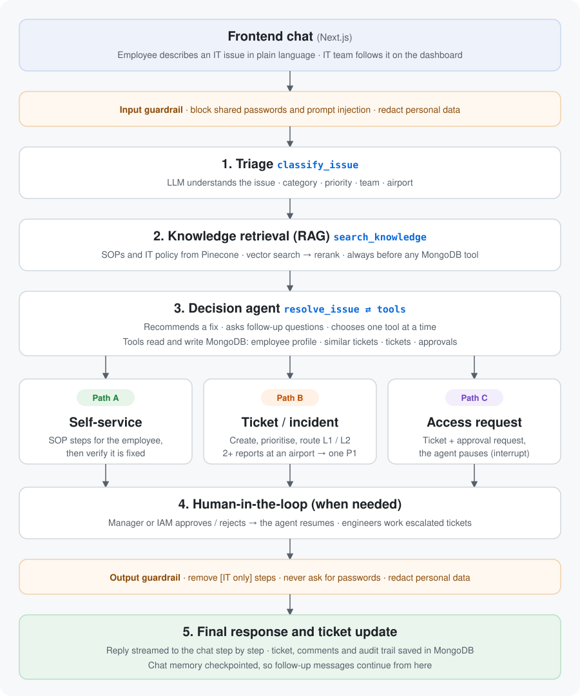
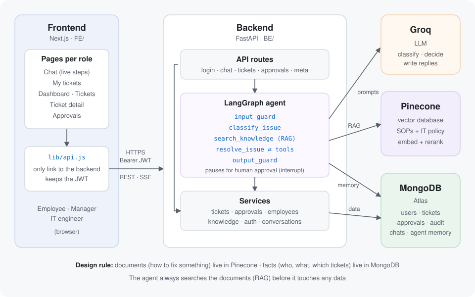
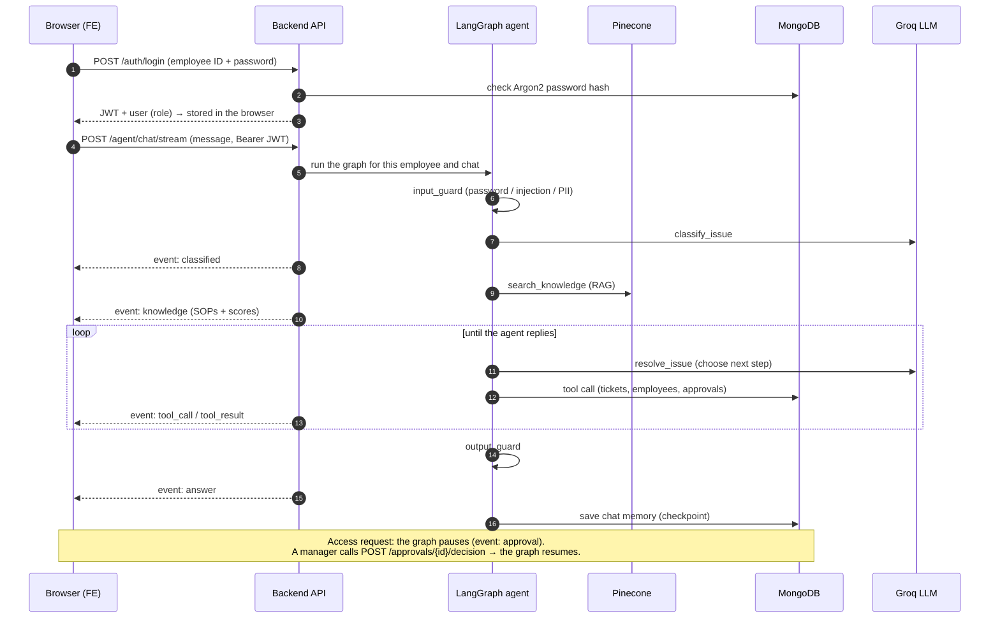

# SkyDesk AI: Agentic IT Helpdesk for an Airline (POC)

An AI agent that acts as the **internal IT helpdesk for every employee of an airline**: check-in agents, cabin crew, gate and baggage staff, airport operations, finance and HR.
An employee describes an IT problem in plain language; the agent understands it, looks up the airline's own procedures, takes action in the ticket system, and hands over to a human whenever a decision is not its to make.

> Demo only. The app and airline names come from `APP_NAME` and `AIRLINE_NAME` in `BE/.env`. All employees, tickets and documents are synthetic.
> This README is the overview. The details live in **[BE/README.md](BE/README.md)** (backend) and **[FE/README.md](FE/README.md)** (frontend).

---

## 1. Goal

Build a working proof of concept of an **agentic** IT service desk:

- **Fix simple problems instantly**, using the right Standard Operating Procedure (SOP).
- **Route everything else correctly**: right team, right priority, L1 or L2.
- **Detect airport-wide outages** instead of opening ten tickets for one problem.
- **Keep humans in control** of sensitive actions such as access requests.

## 2. Problem statement

At an airport, an IT problem stops passengers within minutes: a check-in counter that times out, a boarding pass printer that is offline, a gate with no network.

| Today | Impact |
|---|---|
| Staff phone or email the IT desk and wait in a queue | Simple issues that a known SOP would fix still wait for an engineer |
| An L1 engineer reads each message and routes it by hand | Wrong team or priority; SLA missed |
| Many people at one airport report the same outage separately | Duplicate tickets; nobody notices it is a major incident |
| Access requests arrive by email | Policy not checked, approvals lost, no audit trail |
| SOPs exist in documents nobody reads under pressure | The knowledge exists but is not used |

## 3. How we solve it, and why it is agentic

A chatbot only answers. **An agent decides and acts**, step by step, and every step is visible on screen.

| Capability | How SkyDesk AI does it |
|---|---|
| **Grounded in company knowledge** | RAG: the airline's SOPs and IT policy are searched in a vector database **before** any business data is touched, and answers cite the SOP |
| **Plans and decides** | Chooses self-service, a ticket, a P1 incident or an access approval; L1 or L2 |
| **Uses tools** | 8 tools read and write tickets, employees and approvals in MongoDB |
| **Reasons over history** | Checks similar open tickets at the same airport to spot outages |
| **Human-in-the-loop** | Pauses on access requests; resumes after a manager or the IAM team decides |
| **Memory** | Remembers each chat across messages and server restarts |
| **Guardrails** | Blocks shared passwords and prompt injection, redacts personal data, hides engineer-only steps |

### How the agent handles one issue



**The 4 POC scenarios:**

| Employee says | Agent does |
|---|---|
| "Check-in app shows connection timeout" | SOP self-service steps → ticket if still failing → L1, or L2 if it keeps failing |
| "I need access to the crew scheduling app" | Checks the access policy and the employee's profile → ticket → **pauses for approval** |
| "Boarding pass printer not printing" | Asks for the printer ID and error → SOP steps → Hardware Support ticket |
| "Network down at the Mumbai gates" | Finds several open reports at the airport → **one P1 incident**, L2 → later reporters join it |

## 4. Architecture: the complete picture



| System | Role | Connected to | How |
|---|---|---|---|
| **Frontend** (Next.js) | Screens only; no business logic or data | Backend | HTTPS, JSON, `Authorization: Bearer <JWT>`; address from `NEXT_PUBLIC_API_URL` |
| **Backend** (FastAPI) | Login, roles, endpoints, business rules | Frontend, agent, databases | REST + server-sent events; CORS allows `CORS_ORIGINS` |
| **Agent** (LangGraph) | Decides and acts, step by step | Groq, Pinecone, MongoDB (via tools and services) | Python, inside the backend |
| **Groq** | The LLM: classifies the issue, chooses tools, writes replies | Agent | Groq API (`GROQ_API_KEY`) |
| **Pinecone** | Vector database: SOPs and IT policy (RAG) | Agent, knowledge service | Pinecone API, hosted embedding and rerank models |
| **MongoDB Atlas** | Business data and the agent's chat memory | Services, agent checkpointer | MongoDB driver (`MONGODB_URI`) |

**One rule behind the design:** documents ("how do I fix a printer?") go in **Pinecone**; facts ("who is my manager?", "are others at this airport affected?", "create a ticket") go in **MongoDB**.

## 5. How the frontend and backend talk



- **Login:** the browser keeps the JWT and sends it on every call. The backend reads the employee and role from it, never from the request body.
- **Normal calls** (tickets, approvals, dashboard) are plain REST calls returning JSON.
- **The chat streams:** `POST /agent/chat/stream` answers with server-sent events, one per agent step, so the screen shows the agent working live. RAG always appears before any MongoDB tool.
- **Approvals pause and resume:** the agent stops inside `request_approval`; the manager's decision resumes the same chat.

## 6. Endpoints at a glance

| Area | Endpoints | Used by |
|---|---|---|
| Auth | `POST /auth/login`, `GET /auth/me` | everyone |
| Agent chat | `POST /agent/chat/stream` (live steps), `POST /agent/chat`, `GET /agent/conversations[/{id}]` | employees |
| Tickets | `GET /tickets/mine`, `GET /tickets`, `GET /tickets/{id}`, `PATCH /tickets/{id}` | employees (own), IT support (all) |
| Approvals | `GET /approvals`, `POST /approvals/{id}/decision` | managers (own team), IAM |
| Reference | `GET /meta`, `GET /employees[/{id}]` | frontend, managers, IT |
| Testing | `GET /knowledge/search`, `POST /llm/ask`, `GET /health` | IT support, ops |

Full list with roles and responses: [BE/README.md §11](BE/README.md#11-endpoints). Interactive docs: `<backend URL>/docs`.

## 7. Users and roles

| Role | Who | Can do |
|---|---|---|
| `employee` | Airport, crew, office staff | Chat with the agent; see only their own tickets and chats |
| `manager` | Line managers | Approve or reject their own team's access requests |
| `it_support` | IT engineers | Dashboard, all tickets, update and assign; the `ACCESS_APPROVER_TEAM` may approve any request |

## 8. Demo data

All demo data is synthetic and was created for this POC. It is loaded into the two databases the app uses:

| Where | What | How it got there |
|---|---|---|
| **Pinecone** | Airline knowledge base: SOPs with `[Employee]` / `[IT only]` steps, and the IT service management policy | Documents in `BE/data/kb/`, chunked and embedded by `python -m scripts.ingest_kb` |
| **MongoDB Atlas** | Employees, managers and IT engineers (with roles and line managers), tickets, comments, approvals and audit history | Loaded once for the demo presentation |

The tickets include deliberate patterns for the demo, such as a cluster of open network reports at one airport (incident detection) and repeated check-in timeouts at another (escalation).

## 9. Run it

You need Python 3.11, Node 20+, and free accounts on Groq, MongoDB Atlas and Pinecone.

```bash
# Backend
cd BE
python -m venv .venv && source .venv/bin/activate
pip install -r requirements.txt
cp .env.example .env              # fill in the API keys, MongoDB URI and JWT secret
python -m scripts.ingest_kb       # once: load the SOP documents into Pinecone
uvicorn main:app --reload --port 8000

# Frontend
cd FE
npm install
cp .env.example .env.local        # NEXT_PUBLIC_API_URL = the backend address
npm run dev
```

Open the address printed by `npm run dev` (it must be in `CORS_ORIGINS`) and sign in with a demo employee ID and password.

## 10. Repository

| Folder | What | Details |
|---|---|---|
| `BE/` | FastAPI + LangGraph backend: agent, tools, RAG, MongoDB, guardrails, auth | [BE/README.md](BE/README.md): file-by-file architecture, graph, prompts, data, endpoints |
| `FE/` | Next.js frontend: pages per role, streaming chat | [FE/README.md](FE/README.md): file-by-file architecture, login, streaming, approvals |
| `docs/` | Diagrams used in this README (SVG) | `architecture.svg`, `agent-workflow.svg` |

The backend and frontend are independent projects. Each has its own dependencies, `.gitignore` and `.env.example`. They share no code and talk only over HTTP.
