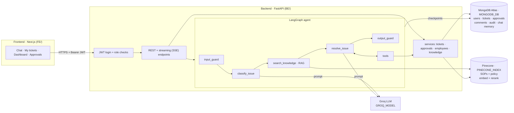

# SkyDesk AI: Agentic IT Helpdesk for an Airline (POC)

SkyDesk AI (`APP_NAME`) is an internal IT helpdesk for **every employee of an Indian airline**: check-in agents, cabin crew, gate and baggage staff, airport operations, finance and HR.
An employee describes an IT problem in plain language. An AI agent then:

1. understands it,
2. looks up the airline's own procedures,
3. decides what to do,
4. takes action in the ticket system,
5. stops and asks a human whenever a decision is not its to make.

> **Demo only.** The airline name comes from `AIRLINE_NAME` in `BE/.env`. All employees, tickets and documents are synthetic demo data in MongoDB and Pinecone.
> This is not a passenger chatbot. Its users are the airline's own staff and IT team.

---

## Contents

1. [The problem](#1-the-problem)
2. [Why an agent (and not a chatbot)](#2-why-an-agent-and-not-a-chatbot)
3. [What it does: the 4 POC scenarios](#3-what-it-does-the-4-poc-scenarios)
4. [How it works: architecture](#4-how-it-works-architecture)
5. [One message, end to end](#5-one-message-end-to-end)
6. [The building blocks](#6-the-building-blocks)
7. [Users and roles](#7-users-and-roles)
8. [Run it locally](#8-run-it-locally)
9. [Repository layout](#9-repository-layout)

---

## 1. The problem

At an airport, IT problems stop passengers from flying. A check-in counter that can't reach the server, a boarding pass printer that is offline, or a gate with no network all cause delays within minutes.

Today these problems reach IT like this:

| What happens today | Why it hurts |
|---|---|
| Staff phone or email the IT desk and wait in a queue | Many issues are simple: a restart fixes them, following a known procedure (SOP) |
| An L1 engineer reads the message, guesses the category, and routes it by hand | Wrong team, wrong priority, SLA missed |
| Ten people at one airport report "network down" separately | Ten tickets for one outage, and nobody notices it is a major incident |
| Access requests come in by email | Nobody checks the policy, approvals are lost, and there is no audit trail |
| SOPs exist in documents nobody reads under pressure | The knowledge exists but is not used |

**Goal:** solve the simple problems instantly with the right SOP, route the rest correctly, and detect airport-wide incidents. Every sensitive action stays under human control.

## 2. Why an agent (and not a chatbot)

A chatbot answers questions. An **agent decides and acts**. SkyDesk AI shows each agentic capability:

| Capability | What it means here |
|---|---|
| **Grounded in company knowledge (RAG)** | Every answer is based on the airline's SOPs and IT policy, retrieved from a vector database *before* the agent touches any business data. Answers cite the SOP ID. |
| **Plans and decides** | It chooses between self-service, a normal ticket, a P1 incident or an access approval, and between L1 and L2. |
| **Uses tools** | Eight tools read and write real data in MongoDB: tickets, employees, approvals. |
| **Reasons over history** | Before acting, it checks for similar open tickets at the same airport, which is how it detects outages. |
| **Asks for missing information** | For hardware it first asks for the device ID and the error. |
| **Human-in-the-loop** | For access requests it **pauses**. A manager or the IAM team approves or rejects, then the agent **resumes**. |
| **Memory** | Each chat is remembered across messages and survives a server restart. |
| **Guardrails** | It blocks shared passwords and prompt injection, redacts personal data, and never shows "IT only" steps to employees. |

## 3. What it does: the 4 POC scenarios

| # | Employee says | What the agent does |
|---|---|---|
| 1 | "Check-in app shows connection timeout" | Classifies it as Check-in Application P2 and retrieves the matching check-in SOP from Pinecone. It checks whether colleagues at the same airport have the same issue, then gives the employee's self-service steps. If they don't work: creates a ticket and assigns L1. Repeated failures go to L2. |
| 2 | "I need access to the crew scheduling app" | Retrieves the access approval policy from Pinecone, reads the employee's profile and manager, creates a ticket, and **pauses for approval**. The manager approves or rejects in the app, and the agent resumes and closes the ticket. |
| 3 | "Boarding pass printer not printing" | Asks for the printer ID and error, gives the steps from the printer SOPs, and raises a Hardware Support ticket if the printer is still offline. |
| 4 | "Network down at Mumbai gates" | Retrieves the network SOP and the major incident procedure, and finds several open network tickets at the same airport. It creates **one P1 incident** linked to them and assigns L2. The next person who reports it is added to the same incident instead of opening a new ticket. |

## 4. How it works: architecture



| Layer | Technology | Why this choice |
|---|---|---|
| Frontend | Next.js 16, React 19, Tailwind 4, shadcn/ui | A simple UI with no business logic. Every screen is one API call to the backend. |
| API | FastAPI | Async Python, automatic `/docs`, native server-sent events for streaming. |
| Agent | LangGraph 1.x + LangChain 1.x | An explicit graph of steps, with tool calling, checkpointed memory and `interrupt()` for human approval. |
| LLM | Groq, model set by `GROQ_MODEL` | Fast, free tier, reliable tool calling. `GROQ_TEMPERATURE` controls how repeatable answers are. |
| Knowledge (RAG) | Pinecone with hosted embedding (`PINECONE_EMBED_MODEL`) and reranking (`PINECONE_RERANK_MODEL`) models | Hosted embedding and reranking, so there are no local models to run. |
| Business data | MongoDB Atlas | Tickets, users and approvals are flexible JSON documents. The same database stores the agent's chat memory. |

**The rule behind the design: unstructured knowledge goes in Pinecone, structured facts in MongoDB.**
"How do I fix a printer?" is answered from Pinecone. "Who is my manager?", "Are others at BOM affected?" and "Create a ticket" go to MongoDB.

## 5. One message, end to end

Example: an airport operations employee in Mumbai types *"Network is down at the Mumbai gates, nothing connects"*.

```
 Browser                         Backend (FastAPI + LangGraph)                       Data
 ───────                         ─────────────────────────────                       ────
 POST /agent/chat/stream  ───►  1. JWT checked → employee ID from the token
 (message, Bearer token)        2. input_guard     no password / injection / PII
                                3. classify_issue  LLM → Network · P1 · Network Support · BOM
 ◄── event: classified
                                4. search_knowledge RAG ─────────────────────────────► Pinecone
 ◄── event: knowledge              network SOP + major incident policy  (RAG_TOP_K → rerank → RAG_TOP_N)
                                5. resolve_issue   LLM reads SOPs, decides: check history
 ◄── event: tool_call              find_similar_tickets(airport=BOM) ─────────────────► MongoDB
 ◄── event: tool_result            several open network tickets at BOM
                                   → policy: 2+ reports = major incident
 ◄── tool_call / tool_result       create_ticket(P1, lists related tickets) ─────────► MongoDB
 ◄── tool_call / tool_result       assign_ticket(Network Support, L2) ────────────────► MongoDB
                                6. output_guard    remove [IT only] lines, redact PII
 ◄── event: answer                 "This looks like an airport-wide outage… <ticket ID>, P1, SLA from SLA_HOURS"
                                7. checkpoint saved ──────────────────────────────────► MongoDB
```

The chat screen draws each event as it arrives, so the viewer sees the agent work: classifying, then searching the knowledge base, then checking tickets, then creating the incident. **RAG always runs before any MongoDB tool.** After the answer, two panels, **Issue analysis** and **Agent steps**, show every step with its data.

## 6. The building blocks

The details live in each part's README:

- **[BE/README.md](BE/README.md): backend**
  - the LangGraph graph, node by node
  - the system prompts
  - all 8 tools
  - RAG: what is in Pinecone and how it is chunked, embedded and reranked
  - MongoDB collections and their dummy data
  - guardrails
  - every endpoint
  - JWT
  - all `.env` keys
- **[FE/README.md](FE/README.md): frontend**
  - pages per role
  - how login and the JWT work in the browser
  - how the chat streams the agent's steps from the backend
  - how approvals resume the agent

A short summary:

| Piece | In one line |
|---|---|
| **Graph** | `input_guard → classify_issue → search_knowledge (RAG) → resolve_issue ⇄ tools → output_guard`. Follow-up messages skip classification and go straight to `resolve_issue`. |
| **Prompts** | `classify_issue.txt` (category, team, priority, airport rules) and `resolve_issue.txt` (the playbook: self-service, incident, escalation, access). |
| **Tools** | search_knowledge_base, get_employee_profile, find_similar_tickets, create_ticket, assign_ticket, update_ticket, get_ticket_status, request_approval |
| **Pinecone** | The synthetic airline documents in `RAG_KB_DIR` (a troubleshooting guide of SOPs and the IT service management policy), chunked and stored in `PINECONE_INDEX`. |
| **MongoDB** | Synthetic demo users (employees, managers, IT engineers) and tickets, with their comments, audit logs and approvals. Chat memory is also stored here. |
| **Auth** | Employee ID + password (Argon2 hash), giving a JWT (`JWT_ALGORITHM`, valid for `JWT_EXPIRE_MINUTES`). Three roles, checked on every endpoint. |
| **Streaming** | `POST /agent/chat/stream` sends server-sent events, one per agent step. |

## 7. Users and roles

| Role | Who | Can do |
|---|---|---|
| `employee` | Check-in agents, crew, gate and baggage staff, ops, finance, HR | Chat with the agent; see **only their own** tickets and chats |
| `manager` | Line managers | Approve or reject access requests from **their own team only** |
| `it_support` | IT engineers (L1/L2) | Dashboard, all tickets, update or assign or resolve tickets, test RAG and the LLM. Engineers in the team named by `ACCESS_APPROVER_TEAM` can also approve anyone's access request. |

Nobody can approve their own request. The frontend hides pages by role, and the backend enforces the same roles on every endpoint.

## 8. Run it locally

You need Python 3.11, Node 20+, and free accounts on Groq, MongoDB Atlas and Pinecone.

```bash
# 1. Backend (API docs at <backend URL>/docs)
cd BE
python -m venv .venv && source .venv/bin/activate
pip install -r requirements.txt
cp .env.example .env                   # then fill in the API keys, MongoDB URI and JWT secret
python -m scripts.ingest_kb            # once: load the SOP documents into Pinecone
uvicorn main:app --reload --port 8000

# 2. Frontend
cd FE
npm install
cp .env.example .env.local             # NEXT_PUBLIC_API_URL = the backend address
npm run dev
```

Open the address printed by `npm run dev` (it must be listed in `CORS_ORIGINS`) and sign in with an employee ID and password from the demo data.
The backend port in the `uvicorn` command must match `NEXT_PUBLIC_API_URL`.

> Every setting lives in `BE/.env` and `FE/.env.local`. Both are gitignored, so never commit them.
> `BE/.env.example` and `FE/.env.example` list every key with example values and are safe to commit.
> On the Groq free tier, each model has a daily token limit. When it is reached, the app shows "The AI assistant is busy".

## 9. Repository layout

```
README.md          this file: the whole picture
BE/                FastAPI + LangGraph backend: see BE/README.md
FE/                Next.js frontend: see FE/README.md
```

The backend and frontend are independent. Each has its own dependencies, and they share no code. They talk only over HTTP.
